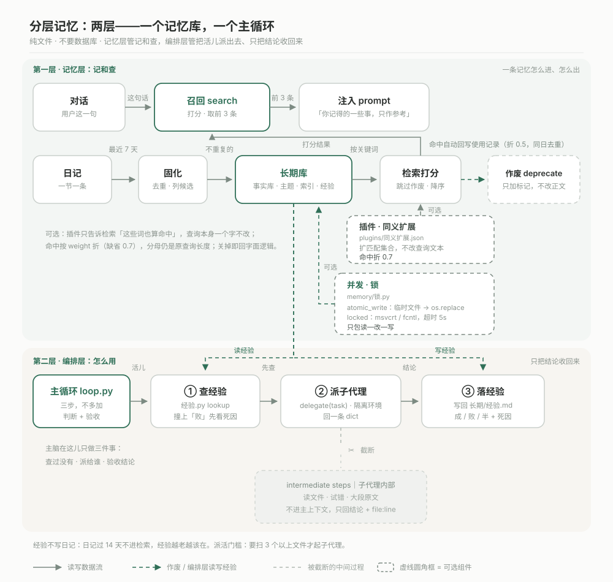

# Layered Memory

一个**纯文件的 AI 记忆库**。记忆就是 markdown 里的一行行字，没有数据库、没有向量、不联网。

检索靠「中文字面重合 × 遗忘曲线 × 来源重要度」打分；过期的事实不用删，在行尾挂一截注释标成作废；每条记忆在账本里留一枚指纹，被改过还是真丢了能分开报。

整套东西分两层：**记忆层**只管记和查；**编排层**（`loop.py`）只管怎么用——查经验、派子代理、把结论落回经验。



图分上下两半，就是这两层：

- **上半 · 记忆层（记和查）**：一条是使用链路，对话 → 召回 → 注入 prompt；另一条是沉淀链路，日记 → 固化 → 长期库（`事实库` / `主题` / `索引` / `经验`）→ 检索打分，打分结果回到召回。旧条目由 `作废` 从侧边挂标记，正文一个字不动，检索默认跳过。检索打分那一步可选挂同义扩展插件（虚线框，`plugins/同义扩展.json`），关掉即回原字面逻辑。写路径旁边还有一只虚线框 `memory/锁.py`：先原子替换再上锁，多个进程同时记账不会读到半截文件。
- **下半 · 编排层（怎么用）**：`loop.py` 三步 —— ① 查经验（`memory/经验.py` 的 `lookup`）→ ② 派子代理（`delegate(task)`，在隔离环境里干）→ ③ 落经验（写回 `长期/经验.md`）。中间那条往下的虚线和 ✂ 是重点：子代理读文件、试错、大段原文这些都**截断在隔离环境里**，不进主上下文；回到主脑的只有一条结论加 `file:line`。两条虚线把两半接起来：① 读经验，③ 写经验，读写的是同一个 `长期/经验.md`。

## 它解决什么

| 麻烦 | 这里的做法 |
| --- | --- |
| 上下文装不下全部历史 | 记忆落在文件里，按需检索，只把命中的 3 条拼进 prompt |
| 事实变了，模型答反 | 旧条目行尾标 `deprecated`，检索默认跳过；不删原文，可回溯 |
| 重要的事被日常噪音淹 | 打分里带来源权重（关系约定 > 事实 > 主题 > 日记），不靠关键词表 |
| 不知道记忆有没有丢 | 账本记 sha256 指纹，`--verify` 分三类报：改写过 / 已废弃 / 整条消失 |

## 30 秒跑起来

只要 Python 3.10+ 和 Node 18+（Node 只有召回脚本用），**没有第三方依赖**。

```bash
python demo.py          # 一条命令跑完整流程：检索 → 作废 → 再检索 → 归档 → 对账
```

想手动来：

```bash
python memory/检索.py 咖啡
python memory/作废.py 咖啡 --reason "改喝焙茶了" --dry
node tools/记忆召回.mjs "偏好"
python tools/记忆账本.py --verify
python loop.py "找 split_status" --grep split_status --path memory --dry
python -m unittest discover -s tests -v
```

仓库里带了一套虚构的示例数据（用户叫「阿舟」），可以直接跑。

中文 Windows 控制台默认 GBK，先 `chcp 65001` 或设 `PYTHONIOENCODING=utf-8`，否则中文显示成乱码（文件本身没事）。

## 三个函数

命令行只是壳。想接进自己的 agent，直接 import：

```python
import sys
sys.path.insert(0, "memory")
import core
```

### `add(text, *, source="事实库", tags=None) -> dict`

往 `data/长期/<source>.md` 追加一条 `- ` 条目；正文已经在库里就不重复写。

```python
>>> core.add("阿舟换了台 32 寸的显示器。", tags=["设备"])
{'key': 'a1b2c3d4e5f60718', 'file': 'data/长期/事实库.md', 'line': 30}
```

`key` = `sha256(正文)[:16]`，和账本、使用记录用的是同一把尺。

### `search(query, *, limit=3, include_deprecated=False, record=True) -> list[dict]`

```python
>>> core.search("咖啡")
[{'text': '阿舟下午三点后不喝咖啡，会睡不着。',
  'src': 'data/长期/事实库.md:12', 'file': 'data/长期/事实库.md',
  'line': 12, 'score': 0.75, 'deprecated': False}, ...]
```

- 分数降序，`limit` 截前几条。
- 日记条目按 `## ` 小节切，`line` 记 0。
- 公式：`重合度 × (0.35 + 0.65 × 可提取度) × (0.5 + 重要度/10)`，
  可提取度默认走 `S = 重要度 × (1 + 0.6 × 被用次数)`，次数来自 `data/使用记录.jsonl` 里 `used: true` 的行。
- **命中会自动记一条使用**：返回的每条（作废条不算）回写一行 `via: "search"`、`weight: 0.5`，按 **0.5** 折算成「用了半次」——搜到不等于用上，权重不许虚高。人显式确认的（`used: true` 且没有 `via` 或 `via: "manual"`）照旧算满值 1.0。
- **同一天、同一个条目只计一次**：反复搜中同一条不再追加新行，文件不会自己膨胀。
- **可以关掉**：纯打分调用传 `record=False`；或者设环境变量 `LAYERED_MEMORY_RECORD=0`，一个字节都不写。

### `deprecate(keyword, *, reason, dry=False) -> dict`

在条目行尾挂 `<!-- status: deprecated | since: | by: -->`，**正文一个字不动**、不删行；顺手把账本里这条的指纹搬家。

```python
>>> core.deprecate("咖啡", reason="改喝焙茶", dry=True)["todo"]
[{'file': 'data/长期/事实库.md', 'line': 12, 'text': '阿舟下午三点后不喝咖啡，会睡不着。'}]

>>> core.search("咖啡")
[]
>>> core.search("咖啡", include_deprecated=True)
[{'text': '阿舟下午三点后不喝咖啡，会睡不着。', ..., 'deprecated': True}]
```

`keyword` 可以是一个字符串（空格分隔 = 必须同时出现），也可以是词列表。`dry=True` 只算不写。

## 子代理经验层（可选）

模型把活儿派给子代理时，子代理的中间步骤不进主上下文、只回一段结论——这是好事，但代价是**踩过的坑也随之丢掉了**。这一层就是把坑留下来。

`memory/经验.py` 往 `data/长期/经验.md` 追加一行，形状和别的记忆条目一模一样，所以检索、作废、账本自动认得它：

```python
import sys; sys.path.insert(0, "memory")
import 经验

经验.record("全仓搜关键字", path="主脑自己 grep 二十个文件", result="败",
            cause="上下文被原文灌满", loc="memory/core.py:141",
            next_try="起子代理，只回 file:line")
经验.lookup("跨文件搜索")     # 复用 core 的打分，只在这份经验里查
经验.recent(5)                # 最后 5 条
```

写进去长这样：

```markdown
- [2026-11-06] 任务：全仓搜关键字 ｜ 路子：主脑自己 grep 二十个文件 ｜ 结果：败 ｜ 死因：上下文被原文灌满 ｜ 位置：memory/core.py:141 ｜ 下次：起子代理，只回 file:line
```

三条硬规矩，写进代码不靠自觉：

- `result` 只认 `成` / `败` / `半`，写别的直接拒绝；
- 结果是 `败` 但没写 `cause` → 拒绝写入。**只写「不行」的记录等于没记**；
- 同一条记第二次返回原来的行号，不重复追加（`core.add` 去重）。

派活门槛也写在库里，供主脑自检：要扫 3 个以上文件或读整个目录 → 派子代理；单点读一个文件、改一行 → 自己动手；同一个坑第二次踩 → 说明这页没查。

## 并发与文件锁（可选）

默认行为不变：不碰 `memory/锁.py` 也照跑，单进程单线程读写跟以前一模一样，零额外依赖。这一层只解决「几个进程 / 线程 / 子代理同时写同一个 md」。

- **先原子写，再上锁**。`atomic_write` 写同目录临时文件 `.tmp-<pid>-<随机>` → `flush` → `os.fsync` → `os.replace` 整篇换上去。读者要么读到旧全文、要么读到新全文，不会读到写了一半的那一版；中途炸了临时文件会被清掉。
- **锁是系统级文件锁，不是拿文件存在与否当占位**。`locked(path, timeout=5.0)` 锁的是同目录的 `<文件名>.lock`：Windows 走 `msvcrt.locking(fd, LK_NBLCK, 1)`（文件至少 1 字节，空的话先写个 `\n`），POSIX 走 `fcntl.flock(fd, LOCK_EX)`。拿不到就轮询，超过 `timeout` 抛 `LockTimeout`（`TimeoutError` 的子类）。`finally` 一定解锁 + 关 fd —— 进程崩了由内核回收，锁不会烂在那儿。
- **只包「读—改—写」**。`rewriting(path)` = 持锁 → 读全文 → `doc.text` → 原子写回；没赋值就不落盘、不产临时文件。`core.add` / `core.deprecate` / `经验.record` / `记忆账本.py --sync` 都走这条路。
- 锁只影响**写**。读不拿锁（靠 `os.replace` 的原子性），所以检索永远不会被正在写的人堵住。
- **Windows 上 `os.replace` 会被「占用」顶回来**。目标文件正被另一个进程 `open` 着时，Windows 直接抛 `PermissionError: [WinError 5] 拒绝访问`（并发写必撞）。`atomic_write` 现在短退避重试：`0.01s` 起、指数退避到 `0.05s` 封顶，总预算 `REPLACE_TIMEOUT = 5.0` 秒（`atomic_write(path, data, timeout=...)` 可覆盖），超出才抛原异常；`EACCES` / `EPERM` 以外的错误（比如目标是目录）一次都不重试，临时文件照旧清掉。
- **读侧也给了一手**。`锁.read_bytes(path, timeout=5.0)` / `锁.read_json(path, default=None, timeout=5.0)`：别人正在 replace 那一瞬读也会短暂 `EACCES`，同样退避重试，超时抛 `ReadTimeout`（`LockTimeout` 的子类）；`read_json` 读到坏 JSON 只往 stderr 打一条 `[WARN]` 并返回默认值，不把检索链带崩。

三条纪律：

1. **持锁期间别调子进程、别走网络、别再递归拿同一把锁**。锁不重入，同一个线程连拿两次会自己等自己，一直等到超时。
2. 锁文件跟目标同目录（`长期/事实库.md.lock`），`__pycache__` 之类不锁。要换等待时间就传参数：`锁.locked(path, timeout=0.3)`。
3. **网络盘不保证**。SMB / NFS 上的 `flock` 语义各家不一致，跨机器同时写别指望它；那种场景要么保证单写者，要么换真数据库。

## 编排层：主循环（第二步）

记忆层只负责**记和查**，`loop.py` 负责**怎么用**——就是架构图下半那三步，不多加：

1. **查** —— `经验.lookup(task)`。这活儿以前干过没有？撞上「败」，先把死因摆出来，再决定换不换思路。
2. **派** —— 把活儿交给 `delegate(task)`。子代理在隔离环境里干，中间过程不进主循环，回来的只有一条 dict。
3. **落** —— `经验.record(...)` 写进 `长期/经验.md`。**不写日记**：日记过 14 天就不进检索了，经验正好相反，越老越该在。

```bash
python loop.py "在 memory 里找 split_status" --grep split_status --path memory --dry
```

```
[1] 查经验：在 memory 里找 split_status
    没走过这条路。
[2] 派活：子代理在隔离环境里干，中间过程不进主循环。
    回传：扫了 7 个文件，命中 3 处
    位置：memory/core.py:58, memory/core.py:158, memory/经验.py:78
[3] 落经验（--dry，不落盘）：
```

注意第 2 步回来的是**位置**，不是内容——这就是「不污染主上下文」的具体形状。

接真模型只要写一个同签名的函数，主循环一个字都不用改：

```python
def my_delegate(task: str) -> dict:
    # …… 调你的模型 / 你的子智能体 ……
    return {"result": "成", "path": "子代理走了哪条路子",
            "conclusion": "一句话结论", "loc": "file:line", "next_try": "下次换什么"}
```

`--fake 成|败|半` 是给测试和演示用的假子代理，别拿它判断真实世界的成败。

## 接真模型（可选）

**不设变量就是假代理，测试不需要网络。** 默认路径是 `memory/代理.py` 的 `make_delegate()`：`LAYERED_MEMORY_DELEGATE` 没设就返回假代理，行为和以前一模一样，一个字节都不发出去。

要挂自己的端点，设三个变量（`URL` 必填，`KEY` 可选、走 `Authorization: Bearer`，`MODEL` 可选）：

```bash
export LAYERED_MEMORY_DELEGATE=http LAYERED_MEMORY_DELEGATE_URL="https://your-endpoint/v1/chat" LAYERED_MEMORY_DELEGATE_KEY="sk-xxxx"
python loop.py "任务" --grep 关键词
```

```powershell
$env:LAYERED_MEMORY_DELEGATE="http"; $env:LAYERED_MEMORY_DELEGATE_URL="https://your-endpoint/v1/chat"; $env:LAYERED_MEMORY_DELEGATE_KEY="sk-xxxx"
python loop.py "任务" --grep 关键词
```

注意上面那条命令里的 `--grep 关键词` 是**本地搜索**（`--grep` 优先级高于环境变量，不调模型）；要让模型接这活，把 `--grep 关键词` 去掉：

```bash
python loop.py "任务"        # 有变量 → POST 你的端点；没变量 → 假代理
```

端点收到 `POST {"task": "...", "model": "..."}`，超时 30 秒。回包认三种形状：直接一条 `{"result": "成"|"败"|"半", "cause": ..., "loc": "file:line"}`；OpenAI 兼容的 `{"choices":[{"message":{"content":"<json 字符串>"}}]}`；或者 `{"content": "<json 字符串>"}`。解析不出来、字段不合法、网络炸了，统一回 `{"result": "败", "cause": "一句人话"}`，主循环照常落经验，不会被打断。

优先级：`--fake` > `--grep` > 环境变量。密钥只进请求头，不落盘、不进日志；错误原因里的 URL 和 Bearer 先脱敏再写出来。

## 命令行怎么用

```bash
python memory/检索.py 咖啡
python memory/检索.py 咖啡 --include-deprecated   # 连作废的也显示，前面带 [废]
python memory/检索.py 咖啡 --legacy-weights       # 用旧权重口径，做对照
python memory/作废.py 咖啡 --reason "改喝焙茶了"
node tools/记忆召回.mjs "他刚说的这句话"           # 拼 prompt 用的那 3 条
python tools/记忆账本.py --verify
python tools/记忆体检.py --line
python memory/经验.py 查 跨文件搜索 -n 3                       # 查这活儿以前怎么干过
python memory/经验.py 最近 -n 5
```

身体上只有两条要记：**账本是先 `--sync` 再 `--verify`**；**作废只作用于 `长期/`，日记不作废**。

## 数据长什么样

```
├─ data/
│  ├─ 长期/
│  │  ├─ 事实库.md          # 一条一行 "- …"
│  │  ├─ 索引.md            # 主题索引
│  │  ├─ 经验.md            # 子代理的工程执行记录（成/败/半 + 死因）
│  │  └─ 主题/*.md          # 关系与约定.md / 零碎见闻.md …
│  ├─ 日记/YYYY-MM-DD.md     # 一天一个文件，一条一个 "## " 小节
│  ├─ 短期记忆.md            # 一份 ≤600 字的交接卡
│  ├─ 记忆权重.json          # {正文: {src, imp, S, last}}
│  ├─ 使用记录.jsonl         # 每次召回一行；检索命中自动回写一行（折 0.5，同日去重）
│  └─ 记忆账本.json          # {sha256: {len, src, text}}
├─ loop.py                   # 主循环：查经验 → 派子代理 → 落经验
├─ memory/                   # core.py + 锁.py（原子写 / 文件锁）+ 六个命令行脚本 + 插件.py
├─ tools/                    # 召回(mjs)、账本、体检
├─ plugins/                  # 可选插件（默认只有一个「同义扩展.json」）
└─ tests/                    # 底线测试
```

一条长期记忆就是一行；作废后只是尾巴长一点：

```markdown
- 阿舟住在城东，通勤靠地铁。
- 阿舟住在城东，通勤靠地铁。 <!-- status: deprecated | since: 2026-03-02 | by: 搬到城西 -->
```

没有标记的一律当 active。

## 换目录也能跑

所有脚本的根目录优先读环境变量 `LAYERED_MEMORY_HOME`，没设就按**脚本自身位置**往上推。
所以拷到别处、放进网盘、挂到移动硬盘，都不用改代码。

```bash
set LAYERED_MEMORY_HOME=E:\somewhere\layered-memory
python E:\somewhere\layered-memory\memory\检索.py 咖啡
```

另一个开关是记账：`LAYERED_MEMORY_RECORD=0` 时 `search()` 只打分、不写 `使用记录.jsonl`（`记忆体检`、只比分数的地方该关掉它）。

## 插件：同义扩展（可选）

第 1 条已知限制是「换个说法就空手」。这一层是**可选**补丁，不动原逻辑：放插件文件才生效，删掉就回到纯字面检索。

- **放哪**：`plugins/同义扩展.json`（和 `memory/`、`tools/` 并列）。仓库自带一份开箱即用的表，16 组。
- **怎么关**：删掉这个文件，或者把里面的 `"enabled": true` 改成 `false`。关掉后零额外开销，分数和没有这层时完全一样。
- **改目录**：环境变量 `LAYERED_MEMORY_PLUGINS` 指哪就只读哪（测试和搬家用），不设就认 `<仓库>/plugins`。

```json
{
  "name": "同义扩展",
  "version": 1,
  "enabled": true,
  "weight": 0.7,
  "groups": [["头疼", "不舒服", "难受"], ["显卡", "gpu", "n卡"]]
}
```

`weight` 是**扩展命中的折减系数**（0~1，缺省 0.7）：真命中算 1.0，靠同义词蹭上的算 `weight`。所以「今天有点头疼」这条，用「头疼」搜是满分口径，用「不舒服」搜拿到的是它的 0.7 倍——同义词只负责"召得回"，不负责"排前面"。

口径两点，别想成别的东西：

1. **不改查询文本**。`expand_query` 只多算出一批「这条记忆里也算命中」的二字组，查询串一个字没动。分母仍是原查询长度，所以扩出来的长串不会把精确命中稀释掉（那正是"把同义词拼进 query 再算 Dice"的通病）。
2. **双向**。组内任一词被查询命中就展开整组，不区分写在前面还是后面；`["显卡","gpu","n卡"]` 里搜 `gpu` 能召回写「N卡」的条目，反过来也一样。

JSON 坏了、字段缺了、`groups` 里塞了非列表——一律当这个插件不存在，记一条警告到 `插件.WARNINGS`，检索照跑不报错。加载器在 `memory/插件.py`：`load(name)` 读一个、`list_all()` 看有哪些。

## 已知限制

1. **字面检索，不是语义检索**。中文按 2 字滑窗算重合，换个说法就空手，这是设计取舍不是 bug。真需要语义就接一层 embedding，但那就不是「纯文件」了。
2. **并发锁只管单机**。同一台机器上多进程写同一个 md 已经安全（`memory/锁.py`：原子替换 + 系统级文件锁）；网络盘上 `flock` 语义不保证，跨机器同时写别指望它。
3. **归档会删原行**，之后 `--verify` 会把它们报成「整条消失」。确认该删就用 `--adopt` 写一条处置记录。
4. **权重涨得慢，而且不许虚高**。`search()` 命中会自动记一条（`via: "search"`，按 0.5 折算，同 key 同日只留一行）；人显式确认过的按满值算（`python memory/记忆曲线.py --mark-used 关键词`，写的是没有 `via` 的老格式）。想安静打分就 `record=False` 或 `LAYERED_MEMORY_RECORD=0`。
5. **`使用记录.jsonl` 基本只增不减**：没有轮转，只有「同 key 同日去重」这一道闸，长期跑要自己按天切。
6. 中文 Windows 控制台要先 `chcp 65001`。

## License

MIT，见 [LICENSE](LICENSE)。
